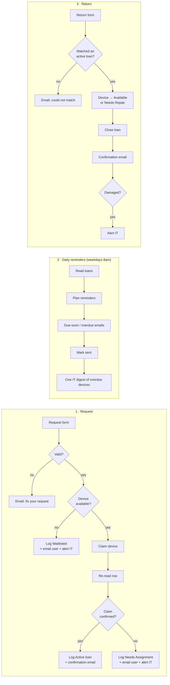

# IT Loaner Device Automation for n8n

Three n8n workflows that run an IT loaner-device program end to end: an employee asks for a loaner laptop, a device gets assigned, they receive reminders before it's due, and IT logs the return. No spreadsheet babysitting, no forgotten devices.

Built with **n8n**, **Google Sheets** (inventory and loan log) and **Gmail**. Import the three files, point them at your sheet, and you're running.

## How it works



## What makes it reliable

| Problem | How it's handled |
|---|---|
| **Two people grab the last laptop at the same moment** | After writing "Checked Out", the workflow re-reads the row and checks its own Loan ID is still there. The loser of the race is told IT will assign by hand, so a device is never given to two people. |
| **Duplicate reminder emails** | Each loan records `Due Soon Sent` and `Last Overdue Notice`. Re-running the reminder workflow the same day sends nothing twice. |
| **Lost reminders** | Rows are marked *after* Gmail succeeds. If sending fails, the reminder goes out on the next run. |
| **Bad form input** | Validation covers email format, device type, dates (no past dates, real calendar dates, max 30 days ahead) and loan length (1–14 days). Every problem is listed in one email. If the email itself is unusable, IT gets the message instead. |
| **Uneven wear on the fleet** | Fair rotation: the device idle longest goes out first. |
| **IT inbox overload** | Overdue devices are summarized in **one** daily digest, not one email each. |
| **Damaged returns** | The device moves to `Needs Repair` (never back into the pool) and IT is alerted with the notes. |
| **Timezone and date bugs** | Dates are stored as plain `YYYY-MM-DD` text and compared as calendar days, so DST changes and the UTC/local boundary don't matter. |

## Tested code

All decision logic lives in [`logic/loaner.js`](logic/loaner.js) as plain functions. [`scripts/build.mjs`](scripts/build.mjs) embeds that exact code into the n8n Code nodes, so the tested code and the code running in n8n are the same.

```bash
npm test     # rebuilds workflows/*.json, then runs 36 tests
```

- **Logic tests:** validation, device picking, race detection, reminder planning, return matching, emails, date edge cases (leap years, DST)
- **Workflow tests:** run each generated Code node with stand-in n8n inputs, check every connection and `$('Node')` reference resolves, and check no credentials are embedded

The generated workflows were also imported into n8n 2.42 and every node's parameters were validated against n8n's own node definitions.

## Setup (about 15 minutes)

1. **Create the Google Sheet.** Make a sheet with two tabs named exactly **`Inventory`** and **`Loans`**. Import [`sample-data/Inventory.csv`](sample-data/Inventory.csv) and [`sample-data/Loans.csv`](sample-data/Loans.csv) (File → Import → *Replace current sheet*).
   Then select the date columns (`Due Date`, `Last Returned`, `Created`, `Start Date`, `Due Soon Sent`, `Last Overdue Notice`, `Returned On`) and choose **Format → Number → Plain text**.
2. **Import the workflows.** In n8n: **Workflows → Import from File**, once each for `workflows/1-request.json`, `2-daily-reminders.json` and `3-return.json`.
3. **Connect credentials.** Open each Google Sheets and Gmail node once and pick your credential (n8n offers to apply it to all similar nodes).
4. **Edit the `Settings` node** in each workflow: sheet URL, IT email, team name, pickup location, and the two form URLs (shown on each form trigger's *Production URL*).
5. **Activate** all three workflows. Share the request form link with employees and keep the return form for the IT desk.

> **Tip:** the return form can be protected with n8n's built-in form authentication (Form Trigger → *Authentication*) so only IT can log returns.

## Sheet layout

**Inventory:** `Asset Tag` · `Type` (Mac / Windows / Chromebook / iPad) · `Model` · `Serial Number` · `Status` (Available / Checked Out / Needs Repair / Retired) · `Loan ID` · `Assigned To` · `Due Date` · `Last Returned` · `Notes`

**Loans** (also your audit log): `Loan ID` · `Created` · `Name` · `Email` · `Device Type` · `Asset Tag` · `Start Date` · `Due Date` · `Reason` · `Status` (Active / Waitlisted / Needs Assignment / Returned) · `Due Soon Sent` · `Last Overdue Notice` · `Returned On` · `Condition` · `Days Late` · `Return Notes`

## Adapting it

- **Helpdesk tickets:** every loan already has a ticket-style ID (`LN-20261002-7F3K`). To mirror loans into ServiceNow, Jira or Freshservice, add an HTTP Request node after *Log loan (Active)*.
- **Microsoft 365 shops:** swap the Gmail nodes for Outlook nodes and the Sheets nodes for Excel Online. The logic doesn't change.
- **Different rules:** max loan length, device types and the 30-day booking window are constants at the top of `logic/loaner.js`. Change them and run `npm run build`.

## License

MIT, free to use and adapt.

---

Built by [Mohamed Elshereif](https://github.com/melshereif). All data in this repo is fictional sample data.
